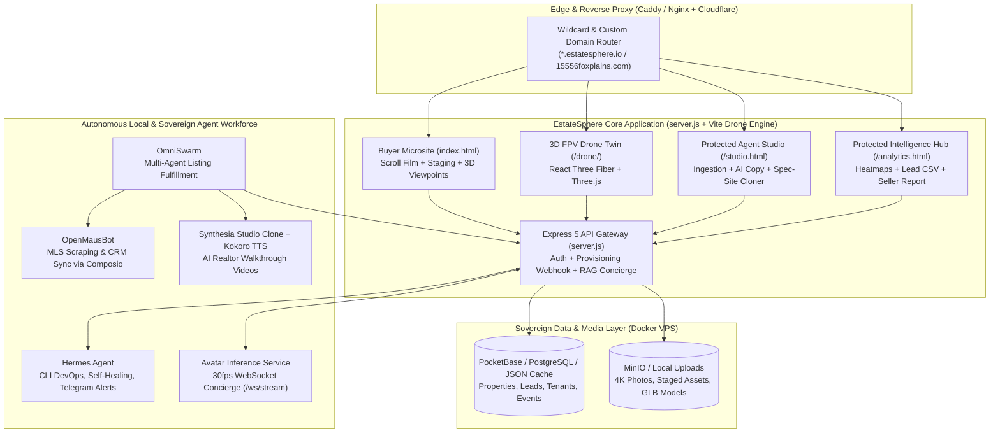
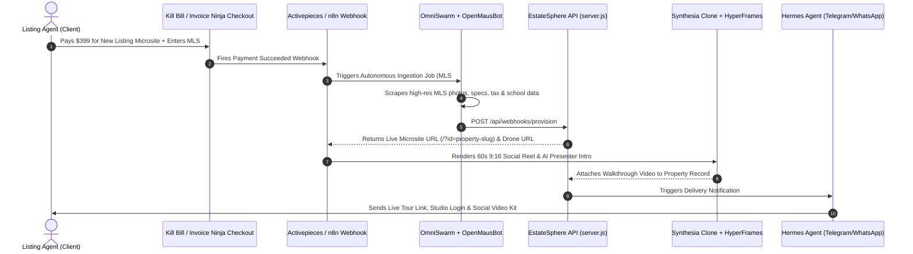

# Fox Plains Estate (EstateSphere) — Master Solopreneur Blueprint

> [!IMPORTANT]
> **Mission Statement**: Transform the [fox-plains-estate](file:///c:/Users/tee/fox-plains-estate/package.json) repository from a single-brokerage prototype into a **100% autonomous, sovereign single-operator ("Solopreneur") PropTech SaaS & Luxury Listing Studio** capable of scaling to 50+ concurrent luxury real estate microsites with zero employees and near-zero recurring SaaS overhead.

---

## 1. Executive Summary: What You Need to Make This a Pure Solopreneur Project

Currently, the codebase provides four core pillars:
1. **Cinematic Buyer Experience** ([index.html](file:///c:/Users/tee/fox-plains-estate/index.html#L1-L1669)) — Scroll-driven 8-scene film, virtual staging switcher ([`setupStagingSwitcher`](file:///c:/Users/tee/fox-plains-estate/index.html#L1405-L1433)), day-to-dusk toggle ([`toggleDusk`](file:///c:/Users/tee/fox-plains-estate/index.html#L1439-L1442)), 5-mode 3D spatial viewer sync ([`setupViewpointSync`](file:///c:/Users/tee/fox-plains-estate/index.html#L1579-L1662)), lead capture ([`tourForm`](file:///c:/Users/tee/fox-plains-estate/index.html#L1455-L1489)), and AI Concierge ([`userSend`](file:///c:/Users/tee/fox-plains-estate/index.html#L1518-L1549)).
2. **3D FPV Drone Twin** ([drone-src/src/App.tsx](file:///c:/Users/tee/fox-plains-estate/drone-src/src/App.tsx#L17-L265)) — React Three Fiber + Three.js interactive spline flight path ([DroneScene.tsx](file:///c:/Users/tee/fox-plains-estate/drone-src/src/components/DroneScene.tsx)) synchronized with room photography ([`listShots`](file:///c:/Users/tee/fox-plains-estate/drone-src/src/lib/shotStore.ts)).
3. **Agent Listing Studio** ([studio.html](file:///c:/Users/tee/fox-plains-estate/studio.html#L852-L1096)) — Multi-property ingestion form, scene editor ([`renderScenesEditor`](file:///c:/Users/tee/fox-plains-estate/studio.html#L907-L930)), file uploader ([`handleFileUpload`](file:///c:/Users/tee/fox-plains-estate/studio.html#L933-L955)), and AI copy generator ([`generateAICopy`](file:///c:/Users/tee/fox-plains-estate/studio.html#L980-L993)).
4. **Agent Intelligence & CRM** ([analytics.html](file:///c:/Users/tee/fox-plains-estate/analytics.html#L513-L633) & [server.js](file:///c:/Users/tee/fox-plains-estate/server.js#L108-L337)) — In-memory JSON persistence (`properties.json`, `leads.json`, `analytics.json`), scene retention heatmaps ([`renderRetentionHeatmap`](file:///c:/Users/tee/fox-plains-estate/analytics.html#L534-L563)), and webhook lead alerts ([`dispatchLeadNotification`](file:///c:/Users/tee/fox-plains-estate/server.js#L156-L184)).

### The 7 Pillars Required for a True Solopreneur Operation

| Pillar | Baseline State | Solopreneur Production State |
| :--- | :--- | :--- |
| **1. Multi-Tenant Auth & Gatekeeping** | `/studio` and `POST /api/properties` are open without auth. | Admin & client token/session authentication (`SOLO_ADMIN_KEY`) so you can sell "Done-For-You" or self-serve microsites to listing agents without exposing other clients' listings or leads. |
| **2. Durable Database & Object Storage** | Writes to local JSON (`persistAsync`) and `/tmp/uploads` on Vercel. | Self-hosted **PocketBase** or **Supabase (PostgreSQL)** + **MinIO** S3-compatible storage on your VPS so uploaded 4K drone videos and leads persist permanently. |
| **3. Billing, Checkout & Auto-Provisioning** | Manual property creation only. | Automated checkout webhook (`POST /api/webhooks/provision`) that provisions a new property microsite slot in `/studio` when a $399 listing order or $297/mo retainer is paid. |
| **4. True LLM + Voice/Avatar Concierge** | Keyword substring matcher (`userSend`) and hardcoded template copy (`generateAICopy`). | Grounded RAG Concierge (`POST /api/concierge/chat`) & AI Copywriter (`POST /api/studio/generate-copy`) powered by **LiteLLM / Spillway + Ollama** with deterministic property-grounded fallback, paired with **Avatar Inference Service** (`/ws/stream`). |
| **5. Automated Virtual Staging & Dynamic 3D Drone** | Manual static image uploads and hardcoded 3D coordinates. | Dynamic `/drone/?id=<slug>` property synchronization + one-click **ComfyUI** ControlNet interior staging pipeline so one person can fulfill a listing in < 15 minutes. |
| **6. Autonomous Outbound & Social Engine** | Manual sharing of `/?id=fox-plains`. | Automated MLS/Zillow spec-site generator + multi-channel social reel publishing (TikTok, IG Reels, YouTube Shorts) from the 8-scene property data. |
| **7. White-Label DNS & Automated Seller Reports** | Single hardcoded domain and manual analytics review. | Custom domain CNAME resolution in `server.js` (`15556foxplains.com` → `fox-plains`) + 1-click **Weekly Seller Marketing Report** & **CSV Lead Export** in `/analytics`. |

---

## 2. Product Requirements Document (PRD)

### 2.1 Product Vision & Business Model
- **Product Name**: EstateSphere Sovereign Studio (built on the `fox-plains-estate` engine)
- **Target Customer**: Independent luxury real estate agents, boutique brokerages, and custom home builders paying $350–$750 per listing for cinematic digital twins, or $297/month for unlimited active microsites.
- **Solopreneur Unit Economics Target**:
  - **Gross Margin**: > 92% (hosted on a single sovereign KVM VPS with open-source tooling; zero per-seat SaaS fees).
  - **Fulfillment Time per Listing**: < 15 minutes from raw listing photos/MLS sheet to live custom-domain microsite + social video kit.

### 2.2 User Personas
1. **The Solopreneur Operator (You)**: Manages infrastructure, runs automated lead-gen scrapers for new listings going live in target metros, oversees automated fulfillment, and collects payouts.
2. **The Listing Agent Client (e.g., Ava Marchetti / Marcus Vance)**: Logs into a scoped `/studio` portal to upload photos, toggle staging, view `/analytics` heatmaps, download weekly seller reports, and receive instant WhatsApp/Telegram showing alerts.
3. **The Prospective Homebuyer**: Explores the scroll-driven film (`/`), flies the 3D drone (`/drone/`), chats with the AI Property Concierge, and books private tours.

### 2.3 Functional Requirements & Acceptance Criteria

#### P0: Core Revenue & Infrastructure Hardening
- **FR-1: Persistent Storage & Media CDN**: Support atomic local JSON persistence (`data/*.json`) with seamless migration path to **PocketBase / PostgreSQL** and **MinIO** object storage.
- **FR-2: Multi-Tenant Authentication & RBAC**: Protect write operations and sensitive endpoints via `x-solopreneur-key` / bearer token when `SOLO_ADMIN_KEY` is configured, while supporting scoped client access.
- **FR-3: Self-Serve Payment & Order Intake (`POST /api/webhooks/provision`)**: Automatically scaffold a complete 8-scene luxury property microsite whenever a payment/order webhook fires from Kill Bill, Invoice Ninja, Stripe, or Activepieces.
- **FR-4: Custom Domain & Subdomain Router (`GET /api/resolve-domain`)**: Resolve custom CNAME domains (e.g. `15556foxplains.com`) or subdomains (`sterling-crest.estatesphere.io`) directly to the matching property ID.

#### P1: AI Automation & Fulfillment Multiplier
- **FR-5: Grounded LLM Property Concierge (`POST /api/concierge/chat`) & Studio Copywriter (`POST /api/studio/generate-copy`)**: Route buyer questions and studio copy generation through a local/sovereign OpenAI-compatible LLM (`LLM_API_URL`, e.g., Ollama / LiteLLM / LM Studio) grounded in the property's exact specs, price, agent info, and knowledge base, with deterministic zero-latency fallback.
- **FR-6: Dynamic 3D Drone Waypoint Synchronization**: Dynamically bind `/drone/?id=<propertyId>` in [drone-src/src/App.tsx](file:///c:/Users/tee/fox-plains-estate/drone-src/src/App.tsx) to `/api/properties/:id` so every property in the portfolio displays its own title, city, bed/bath/sqft specs, and room photography during the 3D flight.
- **FR-7: Per-Property Analytics & Seller ROI Reporting (`GET /api/analytics?propertyId=<id>`)**: Track impressions, staging toggles, 3D dollhouse launches, concierge question streams, and scene retention per property, and generate a client-ready **Seller Marketing Intelligence Report**.

---

## 3. System, Data & Agentic Architectures

### 3.1 High-Level Solopreneur System Architecture

### 3.2 Autonomous "Zero-Touch" Listing Fulfillment Pipeline

---

## 4. Open-Source First Solopreneur Tool Stack

Every software capability required to run, market, monetize, and scale `fox-plains-estate` as a solo operator replaces expensive proprietary SaaS with top community-ranked, self-hostable open-source software vetted via [AlternativeTo.net](https://alternativeto.net/).

### 4.1 Backend, Database & Storage Engine
- **Proprietary Baseline**: Firebase / AWS Amplify / Heroku
- **Open-Source Replacement**: [PocketBase](https://alternativeto.net/software/pocketbase/) / [Supabase](https://alternativeto.net/software/supabase/) + [Coolify](https://alternativeto.net/software/coolify/)
- **License**: MIT (PocketBase) / Apache-2.0 (Supabase & Coolify)
- **Rationale**: Replaces ephemeral cloud storage with real-time SQLite/PostgreSQL subscriptions, built-in multi-tenant auth, S3-compatible media storage, and zero-downtime Docker PaaS deployments on a single VPS.

### 4.2 Workflow Automation & Webhook Bus
- **Proprietary Baseline**: Zapier / Make.com
- **Open-Source Replacement**: [Activepieces](https://alternativeto.net/software/activepieces/) / [n8n](https://alternativeto.net/software/n8n/)
- **License**: MIT (Activepieces Community)
- **Rationale**: Connects [`dispatchLeadNotification`](file:///c:/Users/tee/fox-plains-estate/server.js#L156-L184) (`CRM_WEBHOOK_URL`) and `POST /api/webhooks/provision` to automated SMS/WhatsApp alerts, MLS data enrichment, and weekly seller PDF reports with zero per-task execution fees.

### 4.3 Real Estate CRM & Deal Pipeline
- **Proprietary Baseline**: Salesforce / Follow Up Boss / HubSpot CRM
- **Open-Source Replacement**: [Twenty](https://alternativeto.net/software/twenty/) / [EspoCRM](https://alternativeto.net/software/espocrm/)
- **License**: AGPL-3.0 (Twenty) / GPL-3.0 (EspoCRM)
- **Rationale**: Provides a full self-hosted Kanban deal pipeline for managing both B2B realtor clients and B2C homebuyer tour leads captured via `POST /api/leads` without per-seat CRM pricing.

### 4.4 Private Tour Scheduling & Calendar Sync
- **Proprietary Baseline**: Calendly / ShowingTime
- **Open-Source Replacement**: [Cal.com](https://alternativeto.net/software/cal-com/)
- **License**: AGPL-3.0
- **Rationale**: Upgrades private tour booking to real-time two-way calendar availability checking and automated SMS/email showing confirmations for the listing agent.

### 4.5 AI Gateway & Property Concierge RAG Engine
- **Proprietary Baseline**: OpenAI API Direct / Intercom Fin / Portkey Cloud
- **Open-Source Replacement**: [LiteLLM](https://alternativeto.net/software/litellm/) / [Spillway](https://alternativeto.net/software/spillway/) + [Ollama](https://alternativeto.net/software/ollama/)
- **License**: MIT (LiteLLM & Ollama) / Apache-2.0 (Spillway)
- **Rationale**: Powers `POST /api/concierge/chat` and `POST /api/studio/generate-copy` with local/hybrid LLM routing, zero token markup, and full seller disclosure document RAG.

### 4.6 Virtual Staging & 3D Photogrammetry Suite
- **Proprietary Baseline**: Matterport Cloud / BoxBrownie / Apply Design
- **Open-Source Replacement**: [ComfyUI](https://alternativeto.net/software/comfyui/) (with FLUX.1 / ControlNet) + [OpenDroneMap](https://alternativeto.net/software/opendronemap/) / [Meshroom](https://alternativeto.net/software/meshroom/)
- **License**: GPL-3.0 (ComfyUI) / AGPL-3.0 (OpenDroneMap) / MPL-2.0 (Meshroom)
- **Rationale**: Generates photorealistic virtual staging pairs (`living-vacant.jpg` → `living-staged.jpg`) and converts raw drone footage into 3D textured meshes locally on your GPU at $0 marginal cost.

### 4.7 AI Video Walkthrough & Avatar Presenter
- **Proprietary Baseline**: Synthesia / HeyGen
- **Open-Source Replacement**: [Remotion](https://alternativeto.net/software/remotion/) / Local **Synthesia Studio Clone** + **Kokoro TTS**
- **License**: MIT (Kokoro / Open-Weight Local Pipeline)
- **Rationale**: Produces narrated 60-second luxury property tours and lip-synced digital realtor introductions directly from the 8-scene JSON schema in [`properties.json`](file:///c:/Users/tee/fox-plains-estate/data/properties.json) with zero per-minute rendering fees.

### 4.8 Web Analytics, Heatmaps & Uptime Monitoring
- **Proprietary Baseline**: Google Analytics 4 / Hotjar / Datadog
- **Open-Source Replacement**: [Umami](https://alternativeto.net/software/umami/) / [Plausible Analytics](https://alternativeto.net/software/plausible-analytics/) + [Uptime Kuma](https://alternativeto.net/software/uptime-kuma/)
- **License**: MIT (Umami & Uptime Kuma) / AGPL-3.0 (Plausible)
- **Rationale**: Complements the internal `/api/analytics` engine with cookie-free UTM source attribution, geographic buyer insights, and 60-second health checks against `/api/health`.

### 4.9 Invoicing, Subscriptions & E-Signatures
- **Proprietary Baseline**: Chargebee / DocuSign / QuickBooks
- **Open-Source Replacement**: [Invoice Ninja](https://alternativeto.net/software/invoice-ninja/) / [Kill Bill](https://alternativeto.net/software/kill-bill/) + [Docuseal](https://alternativeto.net/software/docuseal/)
- **License**: Attribution Assurance / Apache-2.0 (Kill Bill) / AGPL-3.0 (Docuseal)
- **Rationale**: Automates per-listing invoicing, monthly brokerage retainers, and media release / listing marketing agreements without recurring SaaS platform fees.

### 4.10 Solopreneur Knowledge Base & Operations HQ
- **Proprietary Baseline**: Notion / Confluence
- **Open-Source Replacement**: [AFFiNE](https://alternativeto.net/software/affine/) / [AppFlowy](https://alternativeto.net/software/appflowy/)
- **License**: MIT (AFFiNE) / AGPL-3.0 (AppFlowy)
- **Rationale**: Stores client SOPs, prompt templates, and local market playbooks with local-first Markdown/canvas synchronization and full data ownership.

---

## 5. Standard Operating Procedures (SOP)

### SOP-01: Daily 15-Minute Morning Pulse (Client Acquisition & Spec-Site Outreach)
1. **Health Check (1 min)**: Verify `/api/health` is green via **Uptime Kuma** / **Hermes Agent**.
2. **Spec-Site Generation (9 min)**:
   - Open `/studio`, click **+ New Client Listing** (or trigger `POST /api/webhooks/provision` via **OpenMausBot**).
   - Enter the target listing's address, specs, and agent contact info, click **AI Generate Narrative** (which calls `/api/studio/generate-copy` to generate the headline, lede, and all 8 scenes), and click **Save & Publish Listing**.
   - Click **Copy Spec-Site Outreach Pitch** in `/studio` to send the realtor their live buyer microsite link (`/?id=<slug>`) and 3D Drone Twin (`/drone/?id=<slug>`).
3. **VIP Lead Triage (5 min)**:
   - Review `/analytics`, filter by property, and export any new leads or send the **Seller Marketing Report** to active clients.

### SOP-02: 15-Minute Client Fulfillment ("MLS-to-Microsite")
1. **Step 1 — Core Parameters (3 min)**: In `/studio`, populate address, price, MLS #, custom domain (`#p-domain`), specs, and agent representation.
2. **Step 2 — AI Narrative & 8-Scene Film (4 min)**: Run `/api/studio/generate-copy` to tailor the 8 scroll scenes (`00 — Aerial Orbit` through `07 — Twilight Elevation`) and upload high-res room photography.
3. **Step 3 — Virtual Staging & Day/Dusk (4 min)**: Upload the vacant & staged photo pairs (`living`, `backyard`) and Day/Dusk exteriors.
4. **Step 4 — Knowledge Base & Verification (4 min)**: Customize Utilities, Schools, and Taxes in `/studio`, save, and verify both `/?id=<slug>` and `/drone/?id=<slug>`.

### SOP-03: Weekly Seller Marketing Report (Client Retention Loop)
1. Every Monday morning, open `/analytics`, select the client's property from `#propertyFilter`, and click **Generate Seller Report**.
2. Send the formatted Seller Marketing Intelligence Digest (Impressions, Tour Duration, Staging Flips, Scene Retention Heatmap, and Buyer AI Questions) to the listing agent so they can impress their homeowner and book their next listing with you.
